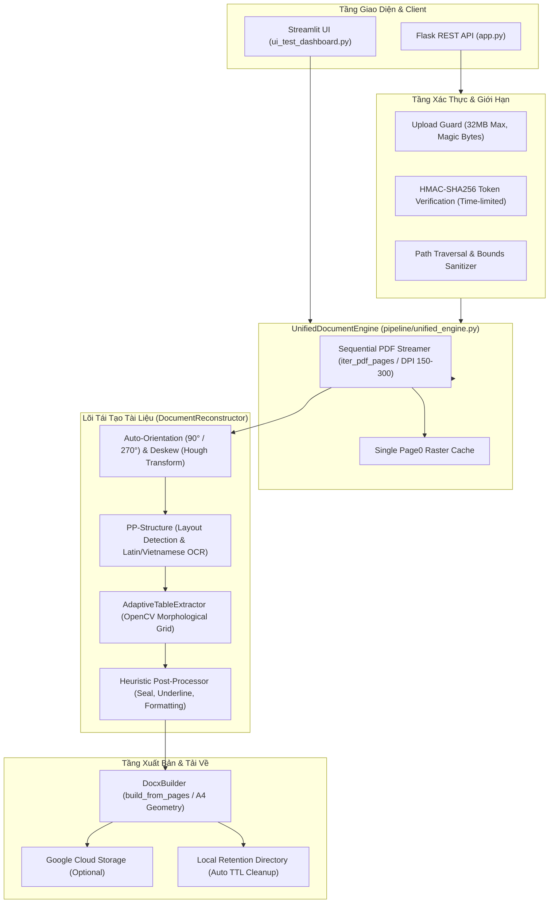
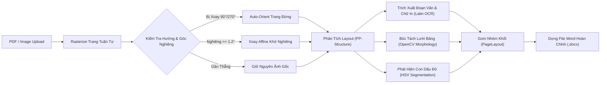

# BE-OCR Core: Document Layout Analysis & Reconstruction Pipeline

Hệ thống OCR và tái cấu trúc tài liệu quét (Scanned PDF & Image) sang định dạng Microsoft Word (`.docx`), phục vụ số hóa văn bản hành chính, hợp đồng và biên bản nghiệm thu.

---

## 🏛️ 1. Kiến Trúc Tổng Thể (System Architecture)

Hệ thống sử dụng lõi **`UnifiedDocumentEngine`** dùng chung cho cả giao diện kiểm thử trực quan (**Streamlit Dashboard**) và dịch vụ web (**Flask REST API**), đảm bảo xử lý nhất quán, tránh trùng lặp logic và tối ưu hóa bộ nhớ:



---

## 🔄 2. Quy Trình Pipeline Xử Lý Từng Trang (Page Processing Flow)




---

## 🛠️ 3. Các Tính Năng Kỹ Thuật Nổi Bật

1. **Xử Lý PDF Tuần Tự (Streaming Memory Efficiency)**:
   - Thay vì nạp toàn bộ các trang PDF vào mảng RAM (dễ gây lỗi OOM trên file lớn), `UnifiedDocumentEngine.iter_pdf_pages()` rasterize và giải phóng bộ nhớ từng trang theo cơ chế generator.
   - Tránh rasterize lặp ở trang đầu tiên khi chạy tự động phát hiện ngôn ngữ qua `cached_first_page`.
2. **Hiệu Chỉnh Hướng & Khử Nghiêng (Auto-Orientation & Deskew)**:
   - Tự động nhận diện mật độ đường viền và phân bố pixel đen để xoay $90^\circ / 270^\circ$ khi văn bản bị quét ngang.
   - Ước lượng góc nghiêng trung vị $\theta_{\text{median}}$ bằng Hough Lines (`cv2.HoughLinesP`) và chỉ xoay khi góc lệch $\ge 1.2^\circ$. Có cờ `enable_deskew` cho phép A/B testing.
3. **Bóc Tách Bảng Thích Ứng (Adaptive Table Extraction)**:
   - Sử dụng kernel hình thái học thích ứng theo tỷ lệ trang để trích xuất vách ngăn ngang/dọc, tránh mất nét viền mờ.
   - Tự động tính toán tỷ lệ độ rộng cột (`proportional column widths`) và chống gãy trang Word (`w:cantSplit`).
4. **Bảo Mật Endpoint & Quản Lý File**:
   - Giới hạn kích thước upload 32MB (`MAX_CONTENT_LENGTH`) và kiểm tra kích thước tối đa 40 triệu pixel chống decompression bomb.
   - Endpoint `/download/<filename>` sử dụng chữ ký **HMAC-SHA256 URL** có giới hạn thời gian (`expires`), so sánh digest bằng constant-time chống timing attack, và kiểm soát chặt chẽ đường dẫn chống Path Traversal.

---

### 🚀 4. Hướng Dẫn Cài Đặt & Sử Dụng

### Yêu Cầu Môi Trường
- Python 3.10 hoặc 3.11 (khuyên dùng Python 3.11 64-bit trên Windows/Linux).
- Cài đặt môi trường ảo `.venv`:

```bash
# Tạo môi trường ảo
python -m venv .venv

# Kích hoạt trên Windows PowerShell:
.venv\Scripts\Activate.ps1
# (Hoặc trên Linux/macOS: source .venv/bin/activate)

# Cài đặt dependencies chuẩn
pip install -r requirements.txt
pip install torch torchvision --index-url https://download.pytorch.org/whl/cpu
```

### 1. Khởi Chạy Giao Diện Trực Quan (Streamlit Dashboard)
```bash
streamlit run ui_test_dashboard.py
```
Truy cập trình duyệt tại `http://localhost:8501`, tải file PDF/ảnh scan để xem trước kết quả phân tích layout và tải file `.docx` được dựng.

### 2. Khởi Chạy REST API Service
```bash
python app.py
```
Dịch vụ chạy tại `http://localhost:5000`:
- **POST `/convert`**: Upload tệp (`file`), trả về JSON kèm `download_url` đã ký HMAC.
- **GET `/download/<filename>?token=...&expires=...`**: Tải tệp kết quả với chữ ký hợp lệ.

---

## 🧪 5. Kiểm Thử Hệ Thống (Testing)

### Chạy Unit Test Suite
Chạy toàn bộ bài kiểm thử tự động của API và `UnifiedDocumentEngine` (kiểm tra upload limits, HMAC tokens, path traversal, bounds validation):
```bash
pytest tests/test_unified_api.py -v
```

---

## 📂 6. Cấu Trúc Thư Mục Dự Án (Project Structure)

```text
be-ocr-core/
├── app.py                                # Flask REST API với bảo mật HMAC & limits
├── ui_test_dashboard.py                  # Streamlit Dashboard trực quan hóa layout
├── requirements.txt                      # Danh sách thư viện và phiên bản chuẩn
├── pipeline/
│   ├── unified_engine.py                 # Service dùng chung (UnifiedDocumentEngine)
│   ├── document_reconstructor.py         # Lõi phân tích layout & gộp phần tử (PP-Structure)
│   ├── adaptive_table_extractor.py       # Thuật toán trích xuất bảng OpenCV thích ứng
│   ├── deskew.py                         # Auto-orient 90°/270° & Hough Deskewer
│   ├── docx_builder.py                   # Bộ dựng file Word đa trang theo tỷ lệ hình học
│   └── language_detector.py              # Bộ phát hiện ngôn ngữ nhanh
└── tests/
    ├── test_unified_api.py               # Unit test suite chính của API & Engine
    ├── pipeline/                         # Test các module con (deskew, builder, table)
    └── evaluation/                       # Khung đo lường & benchmark pipeline
```
