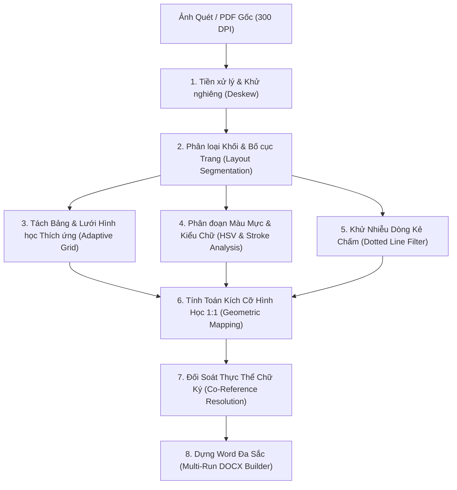

# BE-OCR Core: Kiến Trúc & Quy Trình Tái Tạo Văn Bản (Document OCR & Reconstruction Pipeline)

Tài liệu đặc tả kiến trúc kỹ thuật của hệ thống OCR và tái tạo tài liệu quét (Scanned PDF / Image) sang định dạng Microsoft Word (`.docx`) giữ nguyên cấu trúc hình học, kiểu chữ, màu sắc và kích thước tương đương bản gốc.

---

## 🏗️ 1. Các Mô Hình Học Máy (Models & Engines)

Hệ thống kết hợp mô hình thị giác máy tính chuyên biệt và mô hình chuỗi nhận dạng ký tự:

| Thành phần | Công nghệ / Model | Vai trò kỹ thuật |
| :--- | :--- | :--- |
| **Phân tích Bố cục (Layout Analysis)** | **PaddleOCR - PP-Structure** (`table=True, ocr=True`) | Phát hiện vùng bảng (`table`), khối văn bản (`text`), hình ảnh (`figure`), tiêu đề (`header`). |
| **Nhận dạng Chữ in (Printed OCR)** | **PaddleOCR v4 (Vietnamese/English)** | Trích xuất text in chuẩn công vụ, text trong bảng biểu, nhãn form. |
| **Nhận dạng Viết tay (Handwriting OCR)** | **VietOCR (VGG-Transformer)** | Nhận dạng chữ viết tay điền thêm trên form, tên người ký, chức vụ. |
| **Hình thái học & Xử lý Ảnh (Computer Vision)** | **OpenCV (`cv2`) & NumPy** | Khử nghiêng (Deskew), phân đoạn màu mực (HSV segmentation), trích xuất đường lưới hình học (Morphological Grids). |

---

## 🔄 2. Quy Trình Xử Lý OCR Toàn Diện (End-to-End Pipeline)

---

## ⚙️ 3. Chi Tiết Các Công Đoạn Kỹ Thuật

### Bước 1: Tiền Xử Lý Hình Ảnh (Image Preprocessing & Deskew)
- **Chuẩn hóa kích thước & phân giải**: Ảnh quét từ PDF được trích xuất ở mức $150 - 300\text{ DPI}$ để bảo tồn nét mực mảnh và viền bảng.
- **Tự động khử xoay nghiêng (Deskew)**:
  - Áp dụng bộ lọc Canny cạnh kết hợp phép biến đổi **Hough Line Transform** (`cv2.HoughLinesP`).
  - Lọc các đường thẳng gần nằm ngang ($|\theta| \le 20^\circ$) với độ dài tối thiểu $\ge 8\text{ đoạn}$.
  - Tính góc nghiêng trung vị $\theta_{\text{median}}$ và xoay affine lại ảnh nếu góc nghiêng vượt ngưỡng nhạy cảm ($|\theta| \ge 1.2^\circ$).

### Bước 2: Bóc Tách Bảng Thích Ứng (Adaptive Table Line & Grid Detection)
Thay vì dùng ngưỡng cố định (dễ làm mất viền mờ hoặc đứt nét), hệ thống dùng **Morphological Kernels thích ứng**:
- **Trích xuất viền ngang (`h_morph`)**: Kernel kích thước $\left(\max(12, \text{width} \times 0.025), 1\right)$.
- **Trích xuất viền dọc (`v_morph`)**: Kernel kích thước $\left(1, \max(12, \text{height} \times 0.025)\right)$.
- **Ngưỡng nhị phân động**: Ngưỡng tổng mật độ pixel của hàng/cột:
  $$\text{threshold}_h = \max(0.12 \times W, 0.35 \times \text{max\_row\_sum})$$
  $$\text{threshold}_v = \max(0.12 \times H, 0.30 \times \text{max\_col\_sum})$$
- **Xác định tọa độ ô & Gộp ô động (Cell Span Resolution)**:
  - Giao điểm viền ngang và dọc tạo thành ma trận tọa độ $(x_i, y_j)$.
  - Quét kiểm tra viền ngăn cách giữa các ô lân cận. Nếu một hàng không có vách ngăn dọc (như dòng ghi chú model sản phẩm `Máy tính xách tay ASUS...`), hệ thống tự động gộp ô (`colspan`) mà không làm hỏng cấu trúc các ô 4 cột phía dưới.

### Bước 3: Phân Đoạn Màu Mực & Kiểu Chữ (Color, Style & Stroke Analysis)
- **Tách màu mực bút bi xanh (Handwritten Blue Ink Detection)**:
  - Chuyển vùng ảnh sang không gian màu **HSV**:
    $$\text{Hue} \in [90, 135], \quad \text{Saturation} \ge 45, \quad \text{Value} \in [40, 230]$$
  - Tính tỷ lệ pixel xanh trên tổng pixel nét tối ($\text{ratio}_{\text{blue}} > 0.15$ và số pixel xanh $> 250$).
  - Nếu thỏa mãn: Vùng chữ được gán mã màu xanh bút mực thực tế `RGB(0, 70, 185)`.
- **Nhận diện Gạch Chân (Underline Detection)**:
  - Cắt dải đáy của bounding box ($15\%$ chiều cao chân chữ).
  - Áp dụng kernel ngang mở rộng $\left(\text{width} \times 0.6, 1\right)$. Nếu phát hiện nét thẳng dài liên tục, gán cờ `underline = True`.
- **Nhận diện In Đậm (Bold) & In Nghiêng (Italic)**:
  - Phân tích độ dày nét chữ (Stroke Width Transform / Pixel Density) và góc nghiêng của các đường thẳng đứng trong từ.

### Bước 4: Khử Nhiễu Dòng Kẻ Chấm (Dotted Line Noise Filter)
- **Vấn đề thực tế**: Văn bản hành chính có hàng chấm in sẵn: `Đại diện bên giao: .............................`. Khi ký hoặc viết tay đè lên, các nét bút bi giao cắt với hàng chấm khiến OCR nhận nhầm nét chữ (ví dụ: chữ `P` bị gãy thành `: khạm. Minh... Tiên`).
- **Xử lý**:
  - Lọc hình thái dọn các hạt chấm nhỏ cô lập nằm dưới nét chữ chính.
  - Áp dụng regex khử chuỗi chấm lặp (`\.{2,}`) và chấm kẹp giữa chữ (`([a-zA-ZÀ-ỹ])\.\s+([a-zA-ZÀ-ỹ])`).
  - **Khớp thực thể danh tính chéo trang (Cross-Entity Co-Reference)**: Lấy tên đại diện chuẩn ở khối chữ ký cuối văn bản (nơi tên được in hoặc nhận dạng rõ nét) làm từ điển đối soát. Dùng thuật toán so khớp mờ (`SequenceMatcher` tỷ lệ $\ge 0.70$) để khôi phục chữ viết tay mờ/lỗi mà hoàn toàn **không cần hardcode**.

---

## 📐 4. Phương Pháp Chuẩn Hóa Kích Cỡ & Tỷ Lệ (1:1 Dimensional Mapping)

Để văn bản Word sau khi sinh có kích thước khớp với bản in:

1. **Khổ giấy & Căn lề trang (Page Dimensions & Margins)**:
   - Dựa trên tỷ lệ khung trang gốc:
     $$\text{Nếu } W > H \implies \text{Khổ A4 Ngang } (11.69'' \times 8.27'')$$
     $$\text{Nếu } W \le H \implies \text{Khổ A4 Dọc } (8.27'' \times 11.69'')$$
   - Căn lề 4 phía chuẩn: $0.5''$ (Top, Bottom, Left, Right). Khổ rộng in khả dụng:
     $$W_{\text{printable}} = W_{\text{page}} - 2 \times \text{Margin}$$

2. **Quy đổi Cỡ Chữ Thực Tế (Font Size Pt Calculation)**:
   - Cỡ chữ được tính toán động trực tiếp từ chiều cao hộp bao (Bounding Box Height) theo độ phân giải ảnh quét ($\text{DPI}$):
     $$\text{Size (pt)} = \text{round}\left(\frac{\text{bbox\_height}}{\text{DPI}} \times 72 \times 0.85 \times 2\right) / 2$$
   - Giúp tiêu đề, thân bài, ghi chú chân trang tự động có cỡ chữ tương quan chính xác ($12\text{pt}$, $11\text{pt}$, $8.5\text{pt}$, $6.5\text{pt}$).

3. **Tỷ Lệ Bề Rộng Cột Bảng (Proportional Table Column Widths)**:
   - Chiều rộng của từng cột $j$ trong bảng Word được gán theo tỷ lệ phần trăm tọa độ lưới thực tế:
     $$\text{Width}_j (\text{inch}) = W_{\text{printable}} \times \left(\frac{x_{j+1} - x_j}{\sum \Delta x}\right)$$
   - Thiết lập thuộc tính XML `w:cantSplit` cho từng hàng và `w:tblHeader` cho hàng tiêu đề nhằm chống gãy vỡ layout khi chuyển trang.

4. **Tách Run Đa Sắc Trong Đoạn Văn (Multi-Run Formatting)**:
   - Trong cùng một câu có cả chữ in sẵn và chữ viết tay điền thêm:
     - Nhãn in sẵn (`Đại diện bên giao:`, `Chức vụ:`) $\rightarrow$ Text Run **Màu Đen** (`#000000`).
     - Nội dung điền tay (`Phạm Minh Tiên`, `Thủ kho`) $\rightarrow$ Text Run **Màu Xanh Mực** (`#0046B9`).

5. **Tổ Chức Layout 2 Cột Không Viền (Borderless 2-Column Structures)**:
   - **Khối Đầu Trang**: Logo bên trái và Quốc hiệu / Ngày tháng bên phải được dàn vào bảng 2 cột ẩn viền (`border = none`), đảm bảo căn lề song song tuyệt đối.
   - **Khối Chữ Ký**: Tên chức danh bên giao / bên nhận ở hàng 1, ảnh crop chữ ký thực tế ở hàng 2, và họ tên đại diện ở hàng 3.